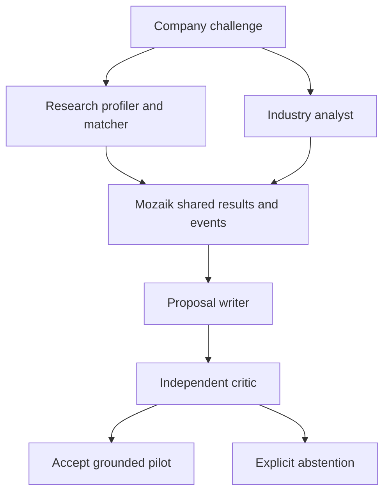
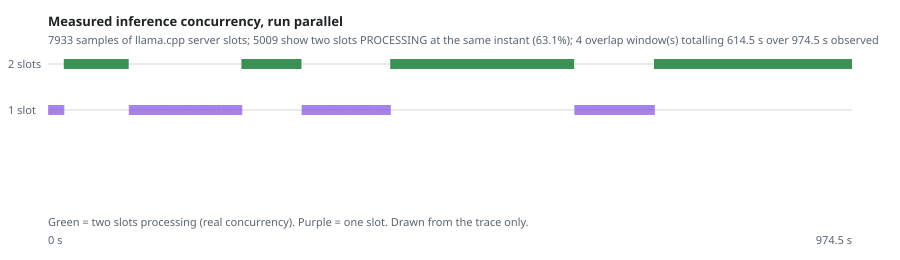

# EINSTEIN Matchmaker

**Track:** EINSTEIN Matchmaker · **Event:** NTP Novi Sad Hackathon (3alet), 30–31 October 2026 · **Entry:** solo

An evidence-constrained matcher between a company's technical challenge and a researcher who
can actually address it. Four Mozaik agents run concurrently on one local Qwen3-4B model. The
system proposes a pilot **only** when it can quote its sources, and it **abstains out loud**
when it cannot.

All people, companies and publications in the dataset are fictional: it is the organizer's
official track corpus.

---

## The one idea behind this

A match and a coincidence look identical from the outside. Two documents sharing the word
"anomaly" is not a link between a researcher and a factory floor — and two HTTP requests in
flight is not two agents thinking at the same time.

So the same discipline is applied twice, at two different levels:

| Level | The easy illusion | What this system requires instead |
|---|---|---|
| **What it says about the world** | lexical overlap looks like expertise | two independently linked research documents, quoted field by field, with record hash, file, JSON pointer and immutable source URL — otherwise it refuses |
| **What it says about itself** | two requests in flight look like concurrency | two *distinct* llama.cpp inference slots observed in `PROCESSING` state at the same instant, inside overlapping Mozaik task intervals, from two distinct producer IDs — otherwise the run is rejected |

A system that cannot refuse cannot be trusted when it accepts. That is the whole design.

---

## Claim status

Nothing below is rounded up. Each line carries what it actually is.

| Claim | Status | Where to check it |
|---|---|---|
| Four distinct Mozaik agents, real local inference, no hosted model API | **PROVEN** | `runs/demo/trace.jsonl`, `evidence/runtime-assets.json` (`hosted_inference_calls: 0`) |
| Two inference slots processing simultaneously — genuine concurrency | **PROVEN** | 5009 of 7933 slot samples in the independently verified block: 63.1 % of observed compute, 614.5 s across 4 windows — `evidence/concurrency-block1-verified.json` |
| Client-side-only and same-agent false concurrency are both rejected | **PROVEN** | `client_only_false_concurrency_rejected` and `same_agent_false_concurrency_rejected` are both `true` in the block verdict |
| The served model is the pinned one, not a substitute | **PROVEN** | `server.model_identity` event compares expected against observed GGUF before any case runs |
| Fabricated or misattributed citations are rejected | **PROVEN** | 28/28 adversarial tests via `npm test`; see `test/evidence.test.mjs` |
| Missing-evidence cases are refused, not answered | **PROVEN** | `runs/demo` case `DEMO_NEG` gives `ABSTAIN / NO_RESEARCH_EVIDENCE` |
| Solo / serial / parallel comparison at equal resource ceilings | **IN PROGRESS — 1 of 12 blocks verified `PASS`** | per-block verdicts under `runs/benchmark-v2/`; the comparison is complete only at 12/12 blocks and 72/72 case-arms |
| Some abstentions are deadline timeouts, not evidence-based refusals | **PROVEN, and counted separately** | 3 of 6 cases in the verified block ended on the clock — `evidence/04-honest-outcomes.png` |
| Parallel execution produces *better* matches than a single agent | **NOT CLAIMED** | no organizer answer key exists — see "What is not claimed" |
| Proposals are useful in the real world | **NOT CLAIMED** | they are labelled proposals; data access, consent, budget and IP remain for the partners to agree |

---

## Run it from a clean folder

Tested on Linux x86-64, Node 24.22.1, Python 3, CPU only. Needs about 6 GiB free RAM and
about 4 GiB of disk for dependencies, index and the local model.

```bash
npm ci --ignore-scripts
python3 scripts/prepare_data.py      # organizer corpus, fetched and checked by content hash
python3 scripts/fetch_runtime.py     # pinned llama.cpp + Qwen3-4B-Q4_K_M, checked by hash
npm test                             # expect 28/28
python3 scripts/run_local.py node src/cli.mjs demo
python3 scripts/independent_verify.py runs/demo
```

The first setup downloads only public, hash-pinned assets. It never calls a hosted model API
and never asks for an API key. The model is served temporarily on `127.0.0.1:18879` with 4
threads and 2 slots; the wrapper terminates it in `finally`. No daemon, no global install, no
cloud pairing, no production configuration.

Outputs land in `runs/demo/`: `proposals.md` (accepted proposals with quotations, source
links, proposed experiments, and the explicit refusals), `trace.jsonl` (Mozaik loop, answer
and peer events, retrieval spans, model requests and responses, critic actions, and the raw
server slot samples), `receipt.json` (corpus, model and runtime hashes, agent identities,
timings, measured resources), and `independent-verification.json`.

To redraw the concurrency measurement for any run:

```bash
python3 scripts/concurrency_figure.py runs/demo evidence/concurrency-demo-qwen3-4b
```

---

## Architecture, and where the concurrency actually is



The research agent and the industry agent run independently through `runLoop` on the same
Mozaik runtime. Retrieval runs on worker threads; both agents then perform real local model
inference — that is the window in which two slots are genuinely busy. The writer consumes
both results from shared state. The critic runs in a fresh agent and model context with a
separate source-audit module: it receives the source evidence and the proposed experiment,
but not the writer's hidden state or retrieval ranking. Peer deliveries are recorded on the
actual Mozaik bus.

An honest limit on the word *independent*: the four roles use the same model weights.
Independence here means a separate agent context and a separate source-audit path. It does
not mean independent model families, independent authorship, or a human expert.

---

## How the concurrency proof works, and how it fails

The verifier does not accept client-side appearances. To pass, a run must show:

1. two distinct Mozaik producer IDs,
2. overlapping task intervals, and
3. at least one timestamp inside that overlap at which **two distinct llama.cpp slots are in
   `PROCESSING` state**.

A negative control deletes all server-slot evidence and **must** be rejected. The serialized
and solo arms are held to the opposite requirement: a mutex, plus three consecutive clean
readings of both slots idle before each call and at every arm boundary, so an arm that claims
to be sequential cannot quietly overlap. A client abort while the server is still busy cannot
start a new solo call.

Measured on the final model, Qwen3-4B-Q4_K_M. The left column is the independently
verified comparison block; the right column is the end-to-end demo run.

| Measure | Verified block (`runs/benchmark-v2/block-1/parallel`) | Demo (`runs/demo`) |
|---|---|---|
| Slot samples taken | 7933 | 2018 |
| Samples with 2 slots processing | 5009 | 807 |
| Share of observed compute in real concurrency | **63.1 %** (5009 / 7933) | 40.0 % (807 / 2018) |
| Overlap windows | 4 | 2 |
| Time in real concurrency | 614.5 s of 974.5 s observed | 98.4 s of 246.5 s observed |
| Maximum simultaneous slots | 2 (server capacity) | 2 (server capacity) |



Every mark in that figure is drawn from the trace. There is no decorative element and no
interpolated value. Regenerate either column with
`python3 scripts/concurrency_figure.py <run dir> <output prefix>`.

### Abstentions are of two different kinds

In the verified block, 2 of 6 cases were accepted, 1 was refused on the evidence
("uncertain link" between the company's problem and the candidate's work), and **3 ran out
of time**. A per-call deadline under a ceiling of four model calls on four CPU threads is
not generous, and a case that ends on the clock has said nothing about its sources.

These are never added together in this repository. The distinction also turns out to be
where the architectures differ: with an equal time budget, the interesting question is not
only who answers better, but **how many cases an arm can finish at all**. That is measured,
not asserted — see the per-block receipts for wall time, model calls, tokens and CPU ticks
per arm.

---

## Evidence, citation and refusal

- Official corpus revision `4fb99b3749adf0d10b5977089ff4c73f4f522240`. `corpus.lock.json`
  records LF-normalized file hashes, so a Windows checkout does not change dataset identity.
- FTS5 retrieval searches profiles, publications, projects and patents, and resolves
  authorship by stable ID — never by matching a name.
- A candidate needs two directly linked research documents and conservative technical-term
  overlap. Researchers marked as departed, or unavailable for projects, are excluded.
- Every factual claim is a quotation of a source field carrying record hash, file, JSON
  pointer or JSONL line, and an immutable official URL.
- A separate Python verifier reconstructs the records from the raw files, independently of
  the application's SQLite index.
- Generated questions, experiments and success thresholds are labelled **proposals**, never
  achieved facts.
- Refusal is triggered by missing evidence, invented IDs, wrong author identity, altered
  quotations or hashes, cross-company source substitution, an unrelated proposal, or an
  uncertain critic result.

Known weaknesses, stated plainly: lexical retrieval can miss a semantic connection;
multilingual normalization is limited; a small model's judgment can be weak; and a valid
source ID does not prove business usefulness. Abstaining is often the right answer — and it
also reduces coverage.

---

## Equal-resource comparison

```bash
python3 scripts/run_local.py node scripts/benchmark_resumable.mjs
python3 scripts/verify_benchmark_v2.py
```

`evaluation/cases.json` was frozen before any benchmark output: 18 challenges sampled across
distinct sector labels, plus 6 explicitly separated missing-evidence controls. The natural
challenges have **no organizer gold labels**. The controls demonstrate refusal when sources
are removed; they do not measure recall over all genuinely unmatched challenges.

Three arms, with the same corpus, retrieval tool, candidate shortlist, prompts, seed and
engine:

| Arm | Mozaik agents | Research / industry execution |
|---|---:|---|
| Solo | 1 | sequential, same four task and tool stages |
| Serial roles | 4 | sequential |
| Parallel roles | 4 | actual simultaneous agent inference |

Identical ceilings per case: 4 model calls, 180 output tokens per call, 14000 prompt
characters per call, 60 retrieved documents, a shortlist of 3, the same 4-thread / 2-slot
server, seed 700, temperature 0. Actual tokens, CPU ticks and wall time are measured and
reported — equal ceilings do not imply equal consumption. Six-case blocks counterbalance arm
order. Model loading sits outside arm time; retrieval and inference sit inside it.

The run is resumable by design: each block is independently verified before it is accepted, a
block interrupted without a receipt goes to **quarantine** rather than being silently
deleted, and a resumed run must use the same frozen source digest. The final verifier refuses
a partial directory — a deliberately incomplete tree returns `BENCHMARK_INCOMPLETE` and exit
code 1. Read the verdict in `runs/benchmark-v2/independent-verification.json`; it is complete
only at `result = PASS` with `case_arm_evaluations = 72`.

---

## What is not claimed

- **No quality uplift from parallelism.** Acceptance counts measure this application's gates,
  not real-world match accuracy and not a jury score. No hidden answer key exists for the
  natural cases. If the measurements show no advantage, this repository will say there is
  none. A speed or quality advantage must be established by measurement, never inferred from
  the number of agents.
- **Generic concurrency instrumentation is prior art.** What is offered as original is the
  combination: source-locked proposals, conservative abstention, independent raw-file
  verification, server-side concurrency evidence, and an equal-resource comparison between
  one agent and four.
- **The system compares fit to a technical task.** It does not rank people's worth. Real
  identities, contact details and private documents are outside this demo, and no message is
  sent to any researcher or company.

## Named unknowns

Being explicit about *which kind* of ignorance each gap is, because that is what says what
would lift it:

| Unknown | Kind | What would lift it |
|---|---|---|
| Does a parallel architecture give better matches? | no ground truth available | an organizer answer key, or blind expert rating of the proposals |
| Would a proposal be accepted by the real partners? | outside the experiment's reach | a pilot with consent, budget and supervisor agreed |
| Is lexical retrieval missing good candidates? | measurable, not yet measured | a recall study against manually built pairs |
| Does the result hold on other hardware? | environment-dependent | a replay on a different CPU, reporting structure and text separately |

---

## Reproducibility and provenance

Dependencies are pinned by `package-lock.json`; dataset, model and engine by content hash.
`evaluation/source-freeze.json` carries the SHA-256 of all 27 executable source files as
frozen for the final comparison. Full prompts and raw responses are retained in the run
traces. A replay should reproduce the evidence links, the gate behaviour and the measurement
structure; bit-for-bit neural generation can still vary with batching and hardware even at
temperature 0, so structural and textual agreement are reported separately.

`evaluation/DEVELOPMENT_DISCLOSURE.md` is required reading before trusting any run under
`runs/`. In short: two earlier model candidates (Qwen3-0.6B, then Qwen2.5-1.5B-Instruct) were
tried and rejected on semantic triage quality, and their negative results are kept rather
than deleted. `runs/development-initial/` is a four-case development pass **on the rejected
0.6B model, before prompt refinements** — it shows a real model and critic event path and
keeps adverse outcomes, but it does **not** certify the final version. Cases N01 to N06 were
inspected during development and must be treated as development-exposed; N07 to N18 were not.
Old experimental receipts are never attributed to the final model.

Prior work and event window: the generic Mozaik SDK setup and the organizer dataset existed
before the event. The source in this repository — index preparation, the agents, the
comparison, the proposals — was authored after the official kickoff on 30 October 2026. See
`BUILD_NOTES.md` and `evaluation/source-freeze.json`.

## Third-party rights

See `THIRD_PARTY_NOTICES.md`. Mozaik and llama.cpp are MIT licensed; the pinned Qwen model is
Apache-2.0. Their assets are fetched from their owners at run time and are not redistributed
here. The organizer supplies its fictional dataset for this track; this repository references
and downloads it, and asserts no redistribution licence over it. The licence for this
repository's own code is in `LICENSE`.
